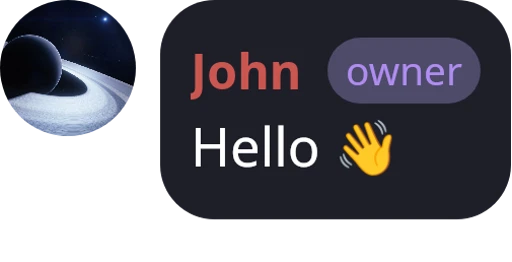

# Chronicler-tg-bot

<p align="center">
  
</p>

Telegram bot that turns chat messages into quote stickers. Supports rich text, emoji (including Telegram custom emoji), photos, albums, videos, replies, member/admin tags, spoilers, message stacks, and saving stickers into sticker packs.

## Features

- **Text formatting**: bold, italic, monospace, underline, strikethrough, mentions and spoilers.
- **Emoji and Unicode**: color emoji, CJK, cuneiform, RTL scripts, and Telegram custom emoji (static ones are rendered as images; animated ones fall back to a preview frame).
- **Media**: photos, albums, stickers, videos and GIFs (preview frame with a play badge), round videos, spoiler blur on media.
- **Replies and forwards**: `/qr` shows the replied message above the quote; forwarded messages keep the original author.
- **Tags**: owner, admin and member tags next to the author name.
- **Message stacks**: up to 6 messages in one sticker, grouped by author.
- **Sticker packs**: save quotes into a chat sticker pack and send random saved quotes.
- **Live UI config**: sizes, paddings and radii are read from a TOML file and reloaded without restarting.

## Architecture

The project consists of two services:

```
┌──────────────┐   multipart (JSON + images)   ┌────────────────────┐
│     bot      │ ────────────────────────────► │      renderer      │
│  (Go, MTProto│ ◄──────────────────────────── │  (Rust, Skia)      │
│   Telegram)  │        WebP sticker           │  POST /v1/render   │
└──────────────┘                               └────────────────────┘
```

| Service    | Language        | Responsibility                                                    |
| ---------- | --------------- | ----------------------------------------------------------------- |
| `bot`      | Go              | Talks to Telegram, collects messages, avatars and media, sends the sticker |
| `renderer` | Rust + Skia     | Lays out the message bubble and renders the sticker as WebP       |

The renderer is internal: it has no authentication and its port must **not** be published to the internet.

## Installation and usage with Docker Compose

### Prerequisites

- Docker / Podman
- Docker Compose / Podman Compose
- Telegram bot token (from [BotFather](https://t.me/BotFather))
- Telegram `API_ID` and `API_HASH` (<https://my.telegram.org/apps>)

### 1. Prepare files

Create a working directory with the following layout:

```
.
├── compose.yaml
├── .env
├── db/ # bot session data (created automatically)
└── config/
       └── config.toml  # UI settings (see below)
```

Create the directories **before** the first start, so they belong to your user and not to root:

```bash
mkdir -p db config
```

`.env`:

```env
APP_ID=123456
API_HASH=your_api_hash
BOT_TOKEN=123456:ABC-your-bot-token
```

### 2. `compose.yaml`

```yaml
services:
  renderer:
    image: geergon/chronicler-renderer:latest
    container_name: chronicler-renderer
    restart: unless-stopped
    volumes:
      - ./config:/app/config:z
    healthcheck:
      test: ["CMD", "curl", "-f", "http://localhost:8080/health"]
      interval: 5s
      timeout: 3s
      retries: 10
      start_period: 20s
    logging:
      driver: json-file
      options:
        max-size: "10m"
        max-file: "3"

  bot:
    image: geergon/chronicler-tg-bot:latest
    container_name: chronicler-tg-bot
    restart: unless-stopped
    env_file:
      - .env
    environment:
      APP_ID: "${APP_ID:?Error: APP_ID not set in .env}"
      API_HASH: "${API_HASH:?Error: API_HASH not set in .env}"
      BOT_TOKEN: "${BOT_TOKEN:?Error: BOT_TOKEN not set in .env}"
      RENDERER_URL: http://renderer:8080
    volumes:
      - ./db:/db:z
    logging:
      driver: json-file
      options:
        max-size: "10m"
        max-file: "3"
    depends_on:
      renderer:
        condition: service_healthy
```

`:z` can be omitted if SELinux is not installed on the system.

### 3. Start

```bash
docker compose up -d
# or
podman-compose up -d
```

The bot starts only after the renderer reports healthy (fonts are loaded on startup, which takes a few seconds).

### Stopping

```bash
docker compose down
```

### Updating

```bash
docker compose pull
docker compose up -d
```

## Configuration

### Environment variables

**bot**

| Variable       | Required | Description                                             |
| -------------- | -------- | ------------------------------------------------------- |
| `APP_ID`       | yes      | Telegram API ID                                         |
| `API_HASH`     | yes      | Telegram API hash                                       |
| `BOT_TOKEN`    | yes      | Bot token from BotFather                                |
| `RENDERER_URL` | yes      | Renderer address, e.g. `http://renderer:8080`           |

**renderer**

| Variable     | Default      | Description                                                    |
| ------------ | ------------ | -------------------------------------------------------------- |
| `PORT`       | `8080`       | HTTP port                                                      |
| `WORKERS`    | `2`          | Number of render threads (each keeps its own copy of the fonts in memory) |
| `FONTS_DIR`  | `./fonts`    | Directory with the font files                                  |

### Volumes

| Mount                              | Purpose                                      |
| ---------------------------------- | -------------------------------------------- |
| `./db:/db`                     | Bot session and databases                    |
| `./config:/config`        | `config.toml` with the sticker look settings |

### UI settings (`config/config.toml`)

If the file does not exist, the renderer creates it with default values on the first start. Changes are picked up **without a restart** (look for `Configuration reloaded successfully` in the renderer logs). If the new file is invalid, the previous settings stay active.

```toml
[ui]
padding_x = 10
padding_y = 12
name_font_size = 46
reply_font_size = 36
text_font_size = 50
gap_after_name = 2
gap_after_reply = 6
reply_line_width = 5
reply_line_gap = 1
corner_radius = 18
avatar_size = 45
avatar_gap = 8
vertical_gap = 4
media_radius = 12
media_group_gap = 6
gap_after_media = 10
bottom_margin = 14
```

- Font sizes are in **points**; all other values are in pixels at 1× scale. The final sticker is scaled so that its longest side is 512 px, so only the proportions matter.
- `bottom_margin` is the empty space below the last bubble (so the message time in Telegram does not cover the text).
- The config directory must be mounted as a **directory**, not a single file: some editors replace the file on save, which would otherwise break change detection. On Docker Desktop (Windows/macOS) file-change events may not reach the container; restart the renderer in that case.

## Commands

| Command        | Description                                                                         |
| -------------- | ----------------------------------------------------------------------------------- |
| `/q`, `/c`     | Create a quote sticker from the message you reply to                                |
| `/q N`, `/c N` | Create a sticker from N messages in a row (maximum 6)                               |
| `/qr`, `/cr`   | Same as above, but with the replied-to message shown above the quote (also supports N) |
| `/cs`          | Save a sticker from a message to the chat sticker pack                              |
| `/crand`       | Send a random saved quote from the chat                                             |
| `/crsave <url>`| Import an existing sticker pack into the quote database                             |
| `/chelp`       | Show help                                                                           |

Select part of a message text in the reply and use `/q` to quote only that fragment.

## Running without Compose

The bot needs to reach the renderer, so put both containers into one network:

```bash
docker network create chronicler

docker run -d --name chronicler-renderer --network chronicler \
  -e CONFIG_DIR=/config -v /path/to/renderer-config:/config:z \
  --restart unless-stopped geergon/chronicler-renderer:latest

docker run -d --name chronicler-tg-bot --network chronicler \
  --env-file /path/to/.env -e RENDERER_URL=http://chronicler-renderer:8080 \
  -v /path/to/db:/db:z --restart unless-stopped geergon/chronicler-tg-bot:latest
```

Podman works the same way (`podman network create`, `podman run`).

## Building from source

```bash
git clone https://github.com/Geergon/Chronicler-tg-bot.git
cd Chronicler-tg-bot
docker compose build
docker compose up -d
```

Repository layout:

```
bot/        Go bot (Telegram, media download, request to the renderer)
renderer/   Rust renderer (Skia layout and drawing, HTTP API)
```

The first renderer build downloads prebuilt Skia binaries and can take a while. Rust tests:

```bash
cd renderer
cargo test
```

## Troubleshooting

- **Bot waits on startup / `renderer is not ready`**: check `docker compose logs renderer`. The renderer must pass its healthcheck first; missing font files are the most common cause.
- **Cannot edit `config.toml` (owned by root)**: the file was created by the container. Fix it once with `sudo chown -R "$USER": renderer/config` and create the directories yourself before the first start.
- **Custom emoji look like regular emoji**: animated custom emoji are shown as a static preview or a fallback emoji; this is expected.
- **No tags shown**: tags of admins are only known if the bot can read the admin list of the chat. Make sure the bot is a member of the group (admin rights are not required for member tags).
- **Sticker is not sent / error in logs**: look for `render:` (renderer problem) or `uploadMedia:` / `sendSticker` (Telegram problem) in `docker compose logs bot`.
